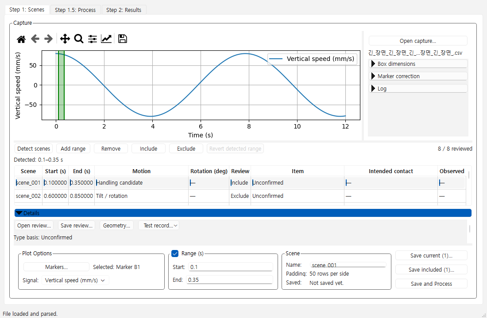
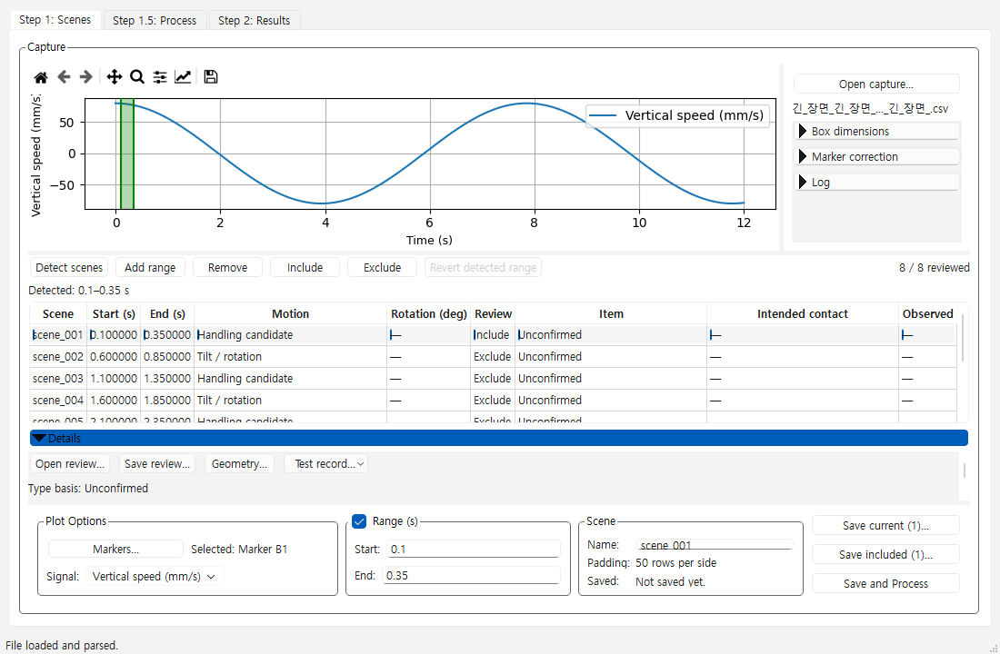

# Step 1 layout proposal

Last Reviewed: 2026-11-11

This is the historical #158 proposal/checkpoint. Its Details accordion, pending
direction statement, measurements and captures describe that proposal's
revision, not the current product. #177 adopts fixed groups/tabs without
accordion; the [current implementation and evidence status](../visualization/gui_public_177.md)
records the replacement layout and maps F2 accessibility checks to it. Preserve
the measurements below as historical evidence rather than current results.

The current task is public-repository work only. Later consumer integration
does not block its implementation, review or publication.

Direction approval is pending under [#158](https://github.com/pikachu444/BoxMotionAnalyzer/issues/158).
The proposed changes were applied to a temporary instance of the existing
Step 1 widgets. The production widgets in the shared-core candidate have
their baseline layout.

The fixture loads a generated marker CSV through the public app and supplies
eight explicit scene ranges. The window uses a long Unicode filename. The
range list, selection, Details, and save controls keep their current order.
The proposal gives four rows enough height, scrolls the contents of Details,
narrows the right-side controls, and uses 9 pt axis titles and a smaller
toolbar icon size. The toolbar still has Home, Back, Forward, Pan, Zoom,
Subplots, Customize, and Save. G3 still requires testing scroll reachability
on smaller client windows. Compare retains its existing layout for the
initial G5–G7 verification.

| Logical client size | Details | Full rows before → proposal | Plot axes before → proposal in pixels |
|---|---|---|---|
| 1510×800 | Closed | 2 → 4 | 1032×278 → 1167×259 |
| 1510×800 | Open | 2 → 4 | 1032×144 → 1167×201 |
| 1100×720 | Closed | 7 → 4 | 703×64 → 760×179 |
| 1100×720 | Open | 2 → 4 | 719×156 → 760×121 |

The narrow expanded state gains width and full rows, and loses plot height.
The implementation still needs to measure that tradeoff, verify the actions,
and preserve user-adjusted fonts during resize. These measurements were
recorded after resizing and toggling Details in sequence. Splitter history
can affect baseline geometry.

The host met the requested minimum FHD physical resolution. Qt reported
2560×1392 available logical pixels, DPR 1.0 and a 9 pt application font.
The widget captures show Qt layout at the current scale. Native Windows
input and the actual Windows 125% scale require separate evidence.

| Baseline, 1100×720 with Details | Proposal, same condition |
|---|---|
|  |  |
