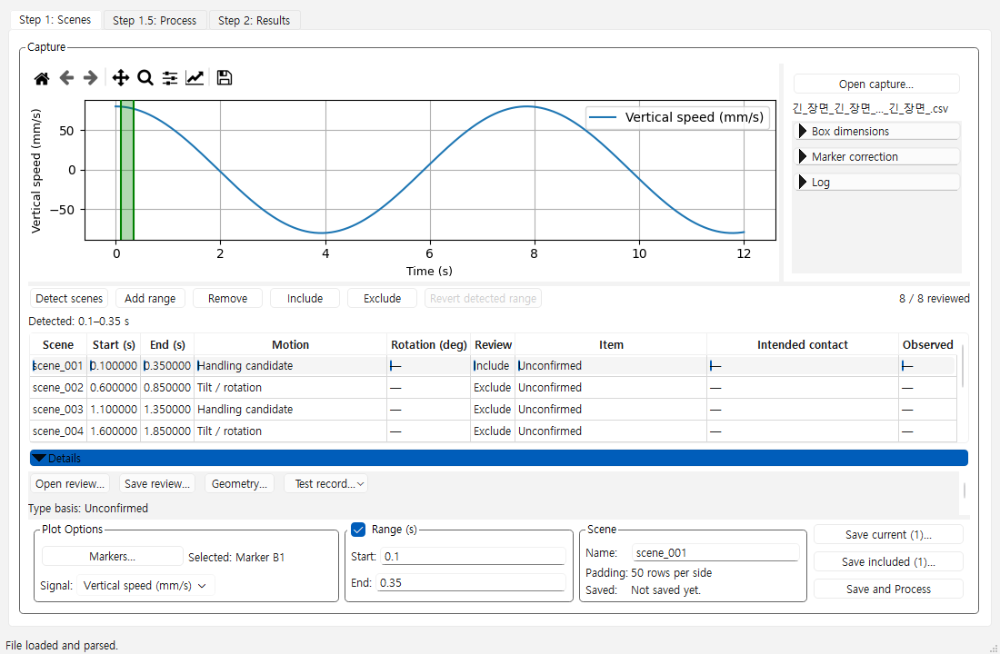

# Step 1 scene and plot layout

Last Reviewed: 2026-11-09

[Issue #158](https://github.com/pikachu444/BoxMotionAnalyzer/issues/158) defines
G1–G7. The revised Step 1 direction was approved on 2026-11-09. The
baseline is d7d61435c89bacda0d87175c06887b1d85f24e2e. The existing splitter
keeps the plot, scene table, Details, and slice controls in their original
order. The scene minimum includes the header, four rows, frame, and any
horizontal scrollbar at the two reference sizes. Narrow Details scrolls
independently. Taller windows can show the entire section. A manual splitter
drag keeps control of the pane sizes.

## Step 1 measurements

The same generated marker CSV and eight explicit scene ranges were used.
Client dimensions are Qt logical pixels. The plot measurements come from
Matplotlib Axes.get_window_extent() in display pixels at DPR 1.0.

| Client size | Details | Full rows before → after | Plot before → after |
|---|---|---|---|
| 1510×800 | Closed | 2 → 4 | 1032×278 → 1170×285 |
| 1510×800 | Open | 2 → 4 | 1032×144 → 1170×233 |
| 1100×720 | Closed | 7 → 4 | 703×64 → 760×205 |
| 1100×720 | Open | 2 → 4 | 719×156 → 760×153 |

The last case gains plot area and full scene rows while giving up about
3 pixels of plot height. The test sequence toggles Details and resizes the
same window. Splitter history affects the baseline. The new default restores
plot height when Details closes. Manual splitter sizes survived the same
toggle in independent review.

The 11 pt application font check retained four rows at the two client sizes.
The narrow open plot became 745×91 pixels. Qt process DPR 1.25 separately
retained four complete rows and the toolbar. The physical desktop was
2560×1440. Native Windows input was observed at OS 100% and DPR 1.0. Actual
Windows 125% is pending. [Qt high-DPI coordinate model](https://doc.qt.io/qt-6/highdpi.html#conceptual-model)

The Windows mouse selected the fourth scene at 1510×800 with Details open,
then included it and invoked Save and Process. The native folder chooser
saved two generated slices. Step 1.5 opened in Batch with Ready to process.
The Qt tests exercised Pan and Zoom via Space, selected the fourth row,
changed Include/Exclude, scrolled to the last row in a smaller window, and
checked that save actions remained visible. Both plot views use 9 pt axis
titles and retain a user-set Matplotlib artist size through resize. The
installed toolbar provides no axis-label font-size control.

| Baseline, 1100×720 Details open | Product, 1100×720 Details open |
|---|---|
| [Baseline Qt capture](https://github.com/pikachu444/BoxMotionAnalyzer/blob/070180ae2850ea8c8ca9bce1a34494366b621118/docs/shared_core/evidence/step1-baseline.png) |  |

[Actual Windows capture, 1510×800 with Details open](step1_scene_layout_158_evidence/windows-1510-details.jpg)

## Comparison and remaining native checks

The same nine generated curves and comparison widgets showed a roughly
one-pixel gain in each plot dimension after the change to 9 pt titles. The
six previously visible actions remain visible and receive keyboard focus.
The existing layout and selection, mode, camera and viewer paths were used
for verification. G5 initial row and geometry passed in the real VTK render
buffer, and G6 list and mode were checked with Qt and native file selection.
The Windows capture of the comparison 3D viewport was blank. Actual desktop
3D visibility and the three native G7 closure cycles remain open.

The independent reviewer found a stale plot height after closing Details.
The correction schedules the default splitter calculation after Qt
relayout. The reviewer confirmed that both target sizes restore the
closed height, and manual sizes remain in control. The existing 1920×1080
trial-action check also detected an overly short Details viewport. The
larger window restores full Details visibility. The Windows suite passed
41 targeted tests after both corrections. See the [execution record](step1_scene_layout_158_evidence/execution.json).

The hosted integration run at 8f8b8b23124548c277d530bd6b7fa8e16377fe02
also found the existing 1400×880 trial-record workflow could not see
Identify items. The revised height rule restores full Details on wide
windows taller than 800 logical pixels. The two approved reference sizes
remain compact. The original trial-record test and 70 related Windows tests
passed together. Independent review confirmed the trial controls are
visible at 1400×880 and the height rule changes correctly on resize.
[Original hosted integration run](https://github.com/pikachu444/BoxMotionAnalyzer/actions/runs/42579429226)

A focused Qt plot probe invoked the existing toolbar actions on the
capture and comparison plots. Back, Forward and Home restored the expected
limits. Pan and Zoom changed modes, and Save wrote a PNG in each view.
The Step 1 Subplots and Customize actions opened their dialogs.
